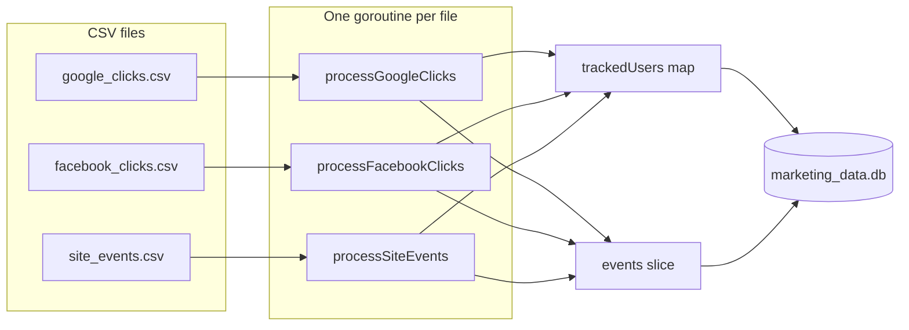
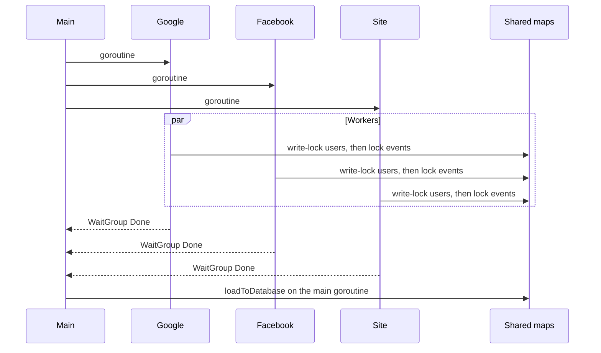

# Marketing ETL pipeline in Go

Concurrent Go ETL that merges Google Ads clicks, Facebook Ads clicks, and website events into SQLite, and deduplicates visitors with a hash of session and device.

The same pipeline runs in the browser: https://eflores1122.github.io/go-marketing-etl-pipeline/

This repository is a portfolio project. The checked-in CSVs are a synthetic extract for Taller Norte, a fictional home-and-clothing shop, written by `scripts/generate_retail.py` with seed `20260311`. They are not a Google or Facebook export and they are not production traffic. The program reads those clicks plus the website event log, deduplicates visitors in memory, and loads two SQLite tables. A SQL file counts multi-channel converters. An Airbyte setup is described below as a proposal only; this program does not call Airbyte.

Run it from the repository root. The database file `marketing_data.db` is created on load and is gitignored.

## Problem

Three CSV extracts describe the same visitors with different keys:

| File | What a row is |
| --- | --- |
| `google_clicks.csv` | A Google Ads click, with campaign, ad group, cost, and `gclid` |
| `facebook_clicks.csv` | A Facebook Ads click, with campaign, ad set, spend, and `fbclid` |
| `site_events.csv` | A website action (`view`, `purchase`, `signup`, or any other `action_type`) |

The job is to produce:

- `tracked_user`: one row per session and device, with the earliest and latest timestamps seen
- `event`: one row per click or site action, pointing at that user
- `bonus_query.sql`: how many tracked users converted after both a Google Ads click and a Facebook Ads click

Rows with a timestamp the parser rejects, an empty `device_type`, or too few columns are skipped and counted. A website row needs seven fields. A Google or Facebook row needs nine, because the loader reads indexes 0 through 8. The CSV reader is set to a variable field count in the file workers and in `runPipeline`, so one short ad row is counted and the rest of that file is still loaded.

## Architecture



`main` starts the three workers, waits for them, then calls `loadToDatabase("./marketing_data.db")`. The `js`/`wasm` build does not call `loadToDatabase`. See [In the browser](#in-the-browser). That function creates the SQLite file when it is missing, runs `CREATE TABLE IF NOT EXISTS` for both tables, and inserts the in-memory rows in one transaction. The database file is not committed.

The load inserts users first and keeps `tracking_hash -> tracked_user_id` for the event insert. An event whose hash was not inserted is skipped. Running the program again appends another full copy; the load does not delete or update existing rows, and there is no unique index on `tracking_hash`.

## Concurrency



`trackedUsers` is guarded by a `sync.RWMutex`. Every upsert takes the write lock for the whole read-modify-write. The code does not call `RLock`. `events` is guarded by a `sync.Mutex` around each append. Workers do not hold both locks at once.

`sync.WaitGroup` reaches zero only after each worker has finished its appends. The load then runs on the main goroutine with no file worker still writing.

Merge rules inside the write lock:

- A new hash inserts a user. `utm_channel` and the initial `user_id` come from that row.
- A later row fills `user_id` only when the stored value is still empty. A non-empty `user_id` is left as-is.
- `utm_channel` is replaced when the new row has an earlier timestamp. If the timestamps are equal, the channel that sorts first is kept. Arrival order does not matter, so a native run and a wasm run agree.
- Later rows do not change `session_key`, `tracking_hash`, or `attributes`.
- `earliest_time` and `latest_time` expand to include the row timestamp. The comparison is lexicographic on `YYYY-MM-DD HH:MM:SS`, which matches chronological order for values this parser accepts.

## Data model

Both timestamps and JSON blobs are stored as text. `attributes` is the literal `{}` on every user. No foreign key is declared.

`tracked_user`

| Column | Type | Meaning |
| --- | --- | --- |
| `tracked_user_id` | integer primary key | Assigned by SQLite at insert |
| `user_id` | text | Source user id, or empty string |
| `session_key` | text | Session from the CSV |
| `tracking_hash` | text | Hex SHA-256 described below |
| `utm_channel` | text | Channel on the earliest event for this hash |
| `attributes` | text | Always `{}` |
| `earliest_time` | text | Earliest event time for this hash |
| `latest_time` | text | Latest event time for this hash |

`event`

| Column | Type | Meaning |
| --- | --- | --- |
| `event_id` | integer primary key | Assigned by SQLite at insert |
| `tracked_user_id` | integer | Id from the user insert in this run |
| `event_time` | text | UTC timestamp `YYYY-MM-DD HH:MM:SS` |
| `event_type` | text | `click`, or the site action, with `purchase` and `signup` stored as `conversion` |
| `source` | text | `Google Ads`, `Facebook Ads`, or `Website` |
| `campaign` | text | Campaign column for ad clicks; empty for website rows |
| `cost` | real | Ad cost; `0` when the number does not parse, and `0` for website rows |
| `revenue` | real | `action_details.value` for site `purchase` and `signup`; otherwise `0` |
| `metadata` | text | JSON object |

Ad metadata uses the campaign column (index 4), not the ad group or ad set column (index 5):

- Google: `{"ad_group":"<campaign>","gclid":"<gclid>"}`
- Facebook: `{"ad_set":"<campaign>","fbclid":"<fbclid>"}`

Website `action_details` is parsed as JSON. `value` is read when it is a JSON number or a numeric string. `purchase` and `signup` are stored as `event_type = conversion`. Any other action type is stored unchanged, and its `value` is not copied into `revenue`. If the details split across extra CSV fields, fields from index 5 up to but not including the last field are joined with commas, and the last field is `utm_channel`.

The checked-in `site_events.csv` is written by the generator with the standard CSV quoting, so `action_details` is valid JSON after `encoding/csv` parses it. `purchase` rows carry `value` as a JSON number, and that number is stored in `revenue`. `signup` rows are conversions with no `value`, so their revenue stays `0`. `view` and `add_to_cart` stay their own event types. A broken JSON object still stores metadata `{}` and revenue `0`; the tests cover that path.

`parseTimestamp` accepts only `2006-01-02 15:04:05`. The layout has no zone, so the clock time is treated as UTC and written back in the same shape.

## Dedup and hashing

```text
tracking_hash = hex(SHA-256(session_key + device_type))
```

There is no separator between the two strings. `session_key = "ab"` with `device_type = "c"` produces the same hash as `session_key = "a"` with `device_type = "bc"`.

The same hash from any file collapses to one in-memory user for that run. A different device on the same session is a different user. The same `user_id` on two sessions is also two users: the pipeline does not resolve identity across sessions. The bonus query joins `tracked_user_id`, so two sessions for one shopper stay two people. On the Taller Norte files, the 17 multi-channel converters are sessions where both ad clicks happen before the conversion on that same session and device.

`bonus_query.sql` counts distinct tracked users who have a `conversion` and, at an earlier `event_time`, both a `Google Ads` click and a `Facebook Ads` click.

## Tech stack

- Go 1.22.2, as declared in `go.mod`. Standard library for CSV, SHA-256, JSON, and `database/sql`.
- `modernc.org/sqlite` v1.34.5, a pure-Go SQLite driver. No CGO.
- Goroutines and mutexes for the three file workers. The SQLite load runs after they finish.
- WebAssembly (`GOOS=js GOARCH=wasm`) for the browser build. That build does not link SQLite.
- [sql.js](https://github.com/sql-js/sql.js) 1.11.0, vendored under `site/vendor/`, for the in-browser query.
- GitHub Actions for `gofmt`, `go vet`, `staticcheck`, race tests, and the wasm smoke check. A second workflow publishes `site/` to GitHub Pages.
- Python 3 is used only by `scripts/generate_retail.py` and `scripts/serve.py`. The ETL itself does not need Python.

## How to run

Requires Go 1.22.2 or newer. The first `go test` or `go run` downloads the module cache. Run these from the repository root:

```bash
test -z "$(gofmt -l .)"
go vet ./...
go test -race -count=1 ./...
go run .
```

`go run .` prints:

```text
ETL completado y datos cargados en marketing_data.db
```

Inspect the file with any SQLite client:

```bash
sqlite3 marketing_data.db < bonus_query.sql
```

GitHub Actions (`.github/workflows/ci.yml`) runs `gofmt`, `go vet`, `staticcheck` v0.5.1, `go test -race -count=1 ./...`, and `scripts/wasm-smoke.mjs` on Ubuntu. The workflow has `contents: read` and no secrets.

Tests are table-driven and live in `etl_pipeline_test.go`. They cover timestamp parsing, the hash (including the no-separator collision), click and website transforms, dedup merge rules, comma rejoin for site details, a missing file, creation of a new database file, append-on-second-load, concurrent upserts, and a full load of the sample CSVs. They also run `runPipeline` on the Taller Norte texts and on a crafted visitor who clicked both ad platforms before a purchase: `bonus_query.sql` against those rows returns the same count as the Go predicate (17 on the sample, 1 on the crafted visitor). A short ad row is skipped and counted by `processGoogleClicks` and by `runPipeline`, including when a later row in the same file is valid. Channel tests check that the earliest event wins regardless of arrival order. They share package-level state, so they stay sequential. `go test -race` is how the mutexes are checked.

## In the browser

GitHub Pages serves the `site/` directory. `.github/workflows/pages.yml` runs the tests, builds `site/etl.wasm` with `GOOS=js GOARCH=wasm`, and deploys the directory with `actions/upload-pages-artifact` and `actions/deploy-pages` on a push to `main` or a manual run. Pages needs `pages: write` and `id-token: write`. The owner already set the Pages source to GitHub Actions.

`modernc.org/sqlite` v1.34.5 does not compile for that target. Building the native program with `GOOS=js GOARCH=wasm` fails because `modernc.org/libc` v1.55.3 has no `GOOS=js` files for `errno`, `pthread`, `signal`, `stdio`, `sys/types`, `time`, and `unistd`. The browser binary leaves `loadToDatabase` out. It exports `runMarketingETL`, which runs the same three ingest workers on CSV text and returns JSON rows. User ids are assigned by ranging the map, the same rule as the SQLite insert on an empty file, so the ids are not stable across processes.

The page inserts those rows into [sql.js](https://github.com/sql-js/sql.js) 1.11.0, SQLite compiled to WebAssembly, and executes `bonus_query.sql` unchanged, comment included. Editable queries on the same tables are extra SQL in the page, not files in this repository. A browser run always starts from an empty database. It does not append, which a second `go run .` does.

TinyGo is not required. The standard Go 1.22.2 toolchain produces the browser binary. Any build that imports `modernc.org/libc` hits the same missing `GOOS=js` files.

```bash
bash scripts/build-site.sh
python3 scripts/serve.py
```

Then open http://127.0.0.1:8765/ . The page shows cost, revenue, ROAS, and conversions for each day from that wasm run.

Regenerate the CSVs from the repository root with `python3 scripts/generate_retail.py`. The script is the only writer of those three files. Do not edit them by hand.

`scripts/wasm-smoke.mjs` runs the wasm binary 20 times on the sample CSVs, checks the totals below, checks that every run keeps the same `utm_channel` for each hash, and runs `bonus_query.sql` in sql.js. CI does that after `go test`.

## Airbyte proposal

This is a design note. There is no Airbyte connector, YAML, or sync job in the repository.

- **Source:** Airbyte Google Ads source, described with an API key, a customer id, and a daily sync. Fields listed: `timestamp`, `user_id`, `campaign`, `cost`, `gclid`, `utm_channel`.
- **Destination:** SQLite file `marketing_data.db`, tables `event` (click events) and `tracked_user`.
- **Schedule:** every day at 00:00 UTC.
- **Transform:** build `tracking_hash` from `session_key + device_type` and merge into existing user rows.

The listed source fields do not include `session_key` or `device_type`, which are the inputs of the hash used by this program.

## Measured run

Numbers below are from `runPipeline` on the Taller Norte CSVs generated with seed `20260311`, measured on 10 November 2026. The same totals are what `go test` and `scripts/wasm-smoke.mjs` require. Twenty wasm calls in one process kept one channel signature.

The generator wrote 460 shoppers and 636 sessions. The pipeline stores one user per session and device, so the user count is 636. Website actions in the file are 2191 `view`, 161 `add_to_cart`, 31 `purchase`, and 21 `signup`. Purchases and signups are stored as `conversion`, which is why the conversion count is 52. Revenue is the sum of purchase `value` only. Signup rows have no `value`.

| Measure | Value |
| --- | --- |
| `tracked_user` rows | 636 |
| `event` rows | 3311 |
| Clicks / views / conversions | 907 / 2191 / 52 |
| Google Ads clicks, total cost | 537, 474.70 |
| Facebook Ads clicks, total cost | 370, 286.21 |
| Website events, total revenue | 2404, 2463.30 |
| Total cost | 760.91 |
| ROAS, revenue / cost | 3.24 |
| Days with events | 26, from 2024-03-04 through 2024-03-29 |
| Website events whose metadata is `{}` | 0 |
| Users with an empty `user_id` | 0 |
| `bonus_query.sql` `multi_channel_converters` | 17 |

ROAS is `2463.30 / 760.91`. The page prints that quotient with two decimal places. Click cost averages about 0.84 and 31 of 907 clicks are followed by a purchase in the generator, so the ratio is the arithmetic of this file, not an industry benchmark.

## Project structure

```text
.
├── etl_pipeline.go        CSV ingest, tracking hash, and in-memory merge
├── run_pipeline.go        in-memory run shared by tests and the wasm export
├── sqlite_load.go         native SQLite load (build tag !js)
├── main_native.go         CLI entry (build tag !js)
├── main_wasm.go           browser entry (build tag js && wasm)
├── etl_pipeline_test.go
├── google_clicks.csv      synthetic Google Ads clicks
├── facebook_clicks.csv    synthetic Facebook Ads clicks
├── site_events.csv        synthetic website events
├── bonus_query.sql        multi-channel converter count
├── scripts/
│   ├── generate_retail.py writes the three CSVs from seed 20260311
│   ├── build-site.sh      builds site/etl.wasm and copies the CSVs
│   ├── wasm-smoke.mjs     checks the wasm totals and bonus_query.sql
│   └── serve.py           local static server for site/
├── site/                  GitHub Pages UI, vendored sql.js, and IBM Plex fonts
└── .github/workflows/     ci.yml and pages.yml
```

`marketing_data.db` is created in the working directory by `go run .` and is gitignored. `scripts/build-site.sh` writes `site/etl.wasm`, `site/wasm_exec.js`, `site/build.json`, and `site/data/`, which are also gitignored.

## Limitations

- The CSVs are synthetic. They are not an ad-platform export and they are not production traffic.
- Ad-click metadata stores the campaign name under `ad_group` or `ad_set`. The ad group and ad set columns are not read.
- A second run appends duplicate users and events. A browser run starts from an empty database.
- `utm_channel` follows the earliest event, then the channel name. It does not follow whichever goroutine took the lock first.
- The tracking hash has no delimiter, so different session/device pairs can collide.
- A Google or Facebook row with fewer than nine columns is skipped and counted. Website rows shorter than seven fields are skipped the same way.
- User ids are not merged across sessions. On this sample, 17 tracked users still have both ad clicks before a conversion, because those clicks share one session and device.
- Log lines for skipped rows and I/O failures are in Spanish. The success line is `ETL completado y datos cargados en marketing_data.db`.
- There is no unique index on `tracking_hash`, no foreign key, and no cross-session identity resolution.
- The Airbyte section is a design note. This program does not connect to Airbyte, Google Ads, or Facebook.

## License

The Go pipeline, tests, scripts, and site page are under the MIT license. See [LICENSE](LICENSE).

Third-party files keep their own terms:

- `site/vendor/` is [sql.js](https://github.com/sql-js/sql.js) 1.11.0 (MIT). See `site/vendor/sql.js.MIT.txt`.
- `site/fonts/` is IBM Plex, under the SIL Open Font License. See `site/fonts/OFL.txt`.
