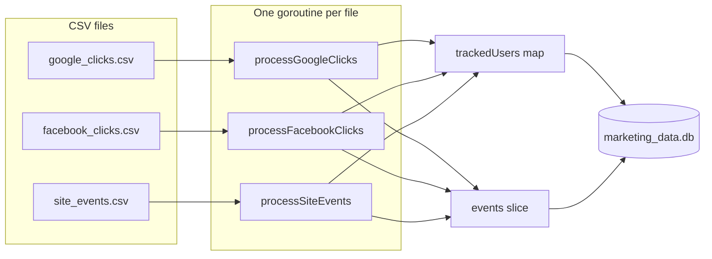
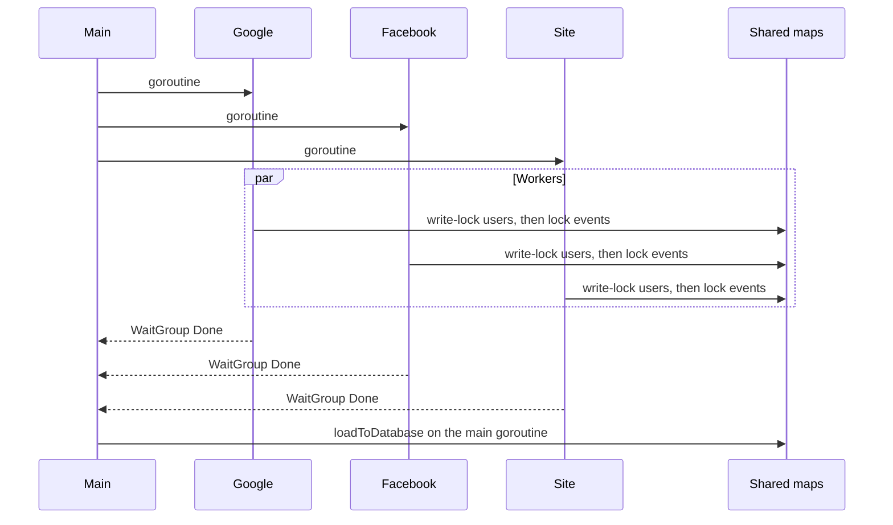

# Marketing ETL pipeline in Go

This repository is a portfolio project built on small sample CSV files. It reads click exports from Google Ads and Facebook Ads plus a website event log, deduplicates visitors in memory, and loads two SQLite tables. A SQL file counts multi-channel converters. An Airbyte setup is described below as a proposal only; this program does not call Airbyte.

Run it from the repository root. The database file `marketing_data.db` is created on load and is gitignored.

## Problem

Three CSV extracts describe the same visitors with different keys:

| File | What a row is |
| --- | --- |
| `google_clicks.csv` | A Google Ads click, with campaign, ad group, cost, and `gclid` |
| `facebook_clicks.csv` | A Facebook Ads click, with campaign, ad set, spend, and `fbclid` |
| `site_events.csv` | A website action (`view`, `purchase`, `signup`, or any other `action_type`) |

The job is to produce:

- `tracked_user`: one row per session and device, with the earliest and latest timestamps seen
- `event`: one row per click or site action, pointing at that user
- `bonus_query.sql`: how many tracked users converted after both a Google Ads click and a Facebook Ads click

Rows with a timestamp the parser rejects, or with an empty `device_type`, are skipped and a log line is written. A website row with fewer than seven fields is skipped the same way.

## Architecture



`main` starts the three workers, waits for them, then calls `loadToDatabase("./marketing_data.db")`. That function creates the SQLite file when it is missing, runs `CREATE TABLE IF NOT EXISTS` for both tables, and inserts the in-memory rows in one transaction. The database file is not committed.

The load inserts users first and keeps `tracking_hash -> tracked_user_id` for the event insert. An event whose hash was not inserted is skipped. Running the program again appends another full copy; the load does not delete or update existing rows, and there is no unique index on `tracking_hash`.

## Concurrency



`trackedUsers` is guarded by a `sync.RWMutex`. Every upsert takes the write lock for the whole read-modify-write. The code does not call `RLock`. `events` is guarded by a `sync.Mutex` around each append. Workers do not hold both locks at once.

`sync.WaitGroup` reaches zero only after each worker has finished its appends. The load then runs on the main goroutine with no file worker still writing.

Merge rules inside the write lock:

- A new hash inserts a user. `utm_channel` and the initial `user_id` come from that first row.
- A later row fills `user_id` only when the stored value is still empty. A non-empty `user_id` is left as-is.
- Later rows do not change `utm_channel`, `session_key`, `tracking_hash`, or `attributes`.
- `earliest_time` and `latest_time` expand to include the row timestamp. The comparison is lexicographic on `YYYY-MM-DD HH:MM:SS`, which matches chronological order for values this parser accepts.

Because `utm_channel` is first-writer-wins, a session that appears in more than one file can keep either file's channel. In the sample data that session is `sess-006` (a Facebook click and a website signup). See the measured runs below.

## Data model

Both timestamps and JSON blobs are stored as text. `attributes` is the literal `{}` on every user. No foreign key is declared.

`tracked_user`

| Column | Type | Meaning |
| --- | --- | --- |
| `tracked_user_id` | integer primary key | Assigned by SQLite at insert |
| `user_id` | text | Source user id, or empty string |
| `session_key` | text | Session from the CSV |
| `tracking_hash` | text | Hex SHA-256 described below |
| `utm_channel` | text | Channel from the worker that created the row |
| `attributes` | text | Always `{}` |
| `earliest_time` | text | Earliest event time for this hash |
| `latest_time` | text | Latest event time for this hash |

`event`

| Column | Type | Meaning |
| --- | --- | --- |
| `event_id` | integer primary key | Assigned by SQLite at insert |
| `tracked_user_id` | integer | Id from the user insert in this run |
| `event_time` | text | UTC timestamp `YYYY-MM-DD HH:MM:SS` |
| `event_type` | text | `click`, or the site action, with `purchase` and `signup` stored as `conversion` |
| `source` | text | `Google Ads`, `Facebook Ads`, or `Website` |
| `campaign` | text | Campaign column for ad clicks; empty for website rows |
| `cost` | real | Ad cost; `0` when the number does not parse, and `0` for website rows |
| `revenue` | real | `action_details.value` for site `purchase` and `signup`; otherwise `0` |
| `metadata` | text | JSON object |

Ad metadata uses the campaign column (index 4), not the ad group or ad set column (index 5):

- Google: `{"ad_group":"<campaign>","gclid":"<gclid>"}`
- Facebook: `{"ad_set":"<campaign>","fbclid":"<fbclid>"}`

Website `action_details` is parsed as JSON. `value` is read when it is a JSON number or a numeric string. `purchase` and `signup` are stored as `event_type = conversion`. Any other action type is stored unchanged, and its `value` is not copied into `revenue`. If the details split across extra CSV fields, fields from index 5 up to but not including the last field are joined with commas, and the last field is `utm_channel`.

The checked-in `site_events.csv` quotes `action_details` with backslashes. After `encoding/csv` parses those rows, the text is not valid JSON, so each website event is stored with metadata `{}` and revenue `0`. The action is still classified (`view` stays `view`; `purchase` and `signup` become `conversion`). A well-formed JSON object does populate revenue; the tests cover that path.

`parseTimestamp` accepts only `2006-01-02 15:04:05`. The layout has no zone, so the clock time is treated as UTC and written back in the same shape.

## Dedup and hashing

```text
tracking_hash = hex(SHA-256(session_key + device_type))
```

There is no separator between the two strings. `session_key = "ab"` with `device_type = "c"` produces the same hash as `session_key = "a"` with `device_type = "bc"`.

The same hash from any file collapses to one in-memory user for that run. A different device on the same session is a different user. The same `user_id` on two sessions is also two users: the pipeline does not resolve identity across sessions. That is why `user-abc` and `user-ghi` can appear on both ad platforms and still fail the bonus query. The query joins `tracked_user_id`, and each sample conversion shares a tracked user with only one ad source.

`bonus_query.sql` counts distinct tracked users who have a `conversion` and, at an earlier `event_time`, both a `Google Ads` click and a `Facebook Ads` click.

## How to run

Requires Go 1.22.2 or newer, as declared in `go.mod`. The SQLite driver is `modernc.org/sqlite` v1.34.5 (pure Go, no CGO). The first `go test` or `go run` downloads the module cache.

```bash
go test -race -count=1 ./...
go vet ./...
go run .
```

`go run .` prints:

```text
ETL completado y datos cargados en marketing_data.db
```

Inspect the file with any SQLite client:

```bash
sqlite3 marketing_data.db < bonus_query.sql
```

GitHub Actions (`.github/workflows/ci.yml`) runs `gofmt`, `go vet`, `staticcheck` v0.5.1, and `go test -race -count=1 ./...` on Ubuntu. The workflow has `contents: read` and no secrets.

Tests are table-driven and live in `etl_pipeline_test.go`. They cover timestamp parsing, the hash (including the no-separator collision), click and website transforms, dedup merge rules, comma rejoin for site details, a missing file, creation of a new database file, append-on-second-load, concurrent upserts, and a full load of the sample CSVs. They share package-level state, so they stay sequential. `go test -race` is how the mutexes are checked.

## Airbyte proposal

This is a design note. There is no Airbyte connector, YAML, or sync job in the repository.

- **Source:** Airbyte Google Ads source, described with an API key, a customer id, and a daily sync. Fields listed: `timestamp`, `user_id`, `campaign`, `cost`, `gclid`, `utm_channel`.
- **Destination:** SQLite file `marketing_data.db`, tables `event` (click events) and `tracked_user`.
- **Schedule:** every day at 00:00 UTC.
- **Transform:** build `tracking_hash` from `session_key + device_type` and merge into existing user rows.

The listed source fields do not include `session_key` or `device_type`, which are the inputs of the hash used by this program.

## Measured run

Numbers below are from this program, executed on 30 October 2026 from the repository root. `marketing_data.db` was deleted before every run. The binary was `go build` of this module.

Twenty runs agreed on every total. Each run printed `ETL completado y datos cargados en marketing_data.db`.

| Measure | Value in all 20 runs |
| --- | --- |
| `tracked_user` rows | 8 |
| `event` rows | 12 |
| Clicks / views / conversions | 8 / 1 / 3 |
| Google Ads clicks, total cost | 4, 2.30 |
| Facebook Ads clicks, total cost | 4, 3.25 |
| Website events, total cost, total revenue | 4, 0.00, 0.00 |
| Website events whose metadata is `{}` | 4 |
| Users with an empty `user_id` | 2 |
| `bonus_query.sql` `multi_channel_converters` | 0 |

The user rows below are from the last of those 20 runs. The counter for the series stored the totals in the table above, not a full dump of every run.

| session_key | user_id | utm_channel | earliest_time | latest_time |
| --- | --- | --- | --- | --- |
| sess-001 | (empty) | google | 2023-01-01 12:00:00 | 2023-01-01 12:05:00 |
| sess-002 | (empty) | google | 2023-01-01 13:00:00 | 2023-01-01 13:00:00 |
| sess-003 | user-ghi | google | 2023-01-02 09:00:00 | 2023-01-02 09:00:00 |
| sess-004 | user-abc | google | 2023-01-02 10:30:00 | 2023-01-02 10:30:00 |
| sess-005 | user-abc | facebook | 2023-01-01 14:00:00 | 2023-01-01 15:00:00 |
| sess-006 | user-def | google | 2023-01-01 14:30:00 | 2023-01-01 16:00:00 |
| sess-007 | user-ghi | facebook | 2023-01-02 10:00:00 | 2023-01-02 11:00:00 |
| sess-008 | user-abc | facebook | 2023-01-02 11:00:00 | 2023-01-02 11:00:00 |

In that run `sess-006` kept `google`, which is the channel on the website row for that session. A further 100 runs of the same binary recorded only `sess-006.utm_channel`: `google` 95 times and `facebook` 5 times. Twenty runs of the program before the readability cleanup produced the same aggregate totals; in that series the same channel was `google` 18 times and `facebook` 2 times.

From the same 20th-run database, Facebook metadata looked like `{"ad_set":"FB Campaign X","fbclid":"FBCLID123"}` with campaign `FB Campaign X` and cost `1.0`. All four website rows had revenue `0.0` and metadata `{}`.

Example hash for `sess-001` / `mobile`:

```text
8febfb777a3edd7d2fb20f27b692082915412bea685c7187c6c8bc911822717a
```

## Behavior worth knowing

- Ad-click metadata stores the campaign name under `ad_group` or `ad_set`. The ad group and ad set columns are not read.
- Sample website revenue is 0 because those `action_details` values do not parse as JSON.
- A second run appends duplicate users and events.
- `utm_channel` depends on which worker inserts the hash first.
- The tracking hash has no delimiter, so different session/device pairs can collide.
- A Google or Facebook row with too few columns panics on index. Website rows shorter than seven fields are skipped.
- User ids are not merged across sessions, so the bonus query's result on this sample is 0.
- Log lines for skipped rows and I/O failures are in Spanish, matching the strings the program already printed. The success line is `ETL completado y datos cargados en marketing_data.db`.
